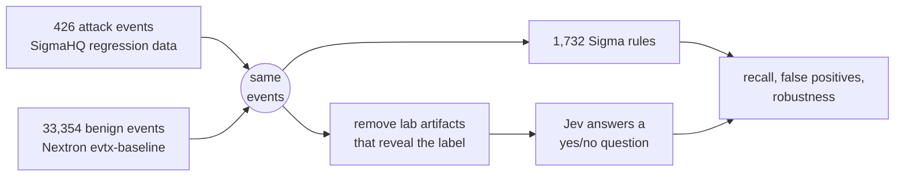
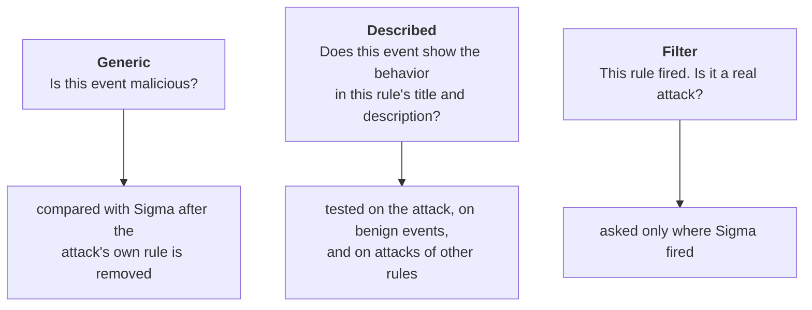
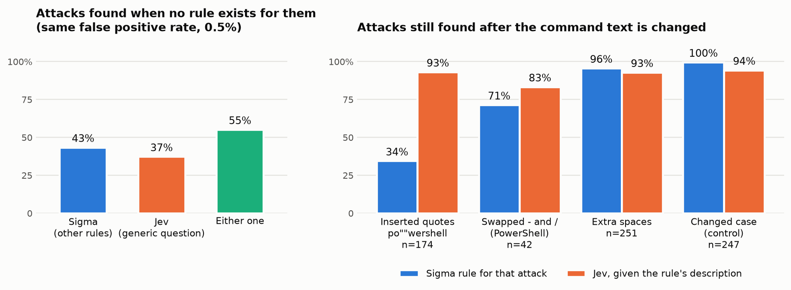

# jev-sigma-bench

A preliminary experiment on whether [Jev](https://openrouter.ai/blog/insights/what-is-jev/), a decision model that returns a probability instead of text, can stand in for [Sigma](https://github.com/SigmaHQ/sigma) rules when the job is to spot attacks in Windows event logs.



Jev was asked three kinds of question, so that it could be measured as a detector with no rule, as a rule written in plain language, and as a second opinion on Sigma's alerts.



## Results



With no rule to guide it, Jev finds about as many unseen attacks as the rest of the Sigma rule set does at the same false positive rate, although the two catch different attacks and together reach 55%. Once Jev is given the two sentences that describe a rule, it detects the matching attack for 89% of the 405 rules while firing on 0.5% of benign events, and it keeps working when the command text is rewritten in ways that break most exact-match rules. As a filter on Sigma's alerts it was weak, because removing 57% of the false alerts also cost 16% of the true ones.

The whole run made 36,934 requests to `typesafe/jev-1.14` for $0.98.

## Read these numbers with care

The benign events come from clean lab machines with almost no administrator activity, so every false positive rate here is a lower bound, and the rewritten commands were generated automatically and never executed on Windows to confirm that they still work.

## Open questions

These results are preliminary, and anyone is welcome to build on them, starting perhaps with these three questions.

1. How do these false positive rates change on logs that contain real administrator work, where both rules and models are expected to struggle?
2. Does Jev hold up when an attacker writes text into the event to steer its answer, and how stable are its probabilities across repeated calls?
3. Can a cheap first filter make it affordable to check every event against every rule description, and does judging a sequence beat judging one event?

## Reproduce

```bash
./setup.sh && uv venv && uv pip install pyyaml evtx httpx matplotlib
uv run python -m bench.build_baseline && uv run python -m bench.sigma_arm
export OPENROUTER_API_KEY=...
uv run python -m bench.jev_arm && uv run python -m bench.summary && uv run python -m bench.chart
```

The Sigma evaluator and the data pairing come from [sigma-llm-bench](https://github.com/Ayush-M99/sigma-llm-bench), and the text changes follow [Uetz et al., 2024](https://www.usenix.org/conference/usenixsecurity24/presentation/uetz). MIT license.
